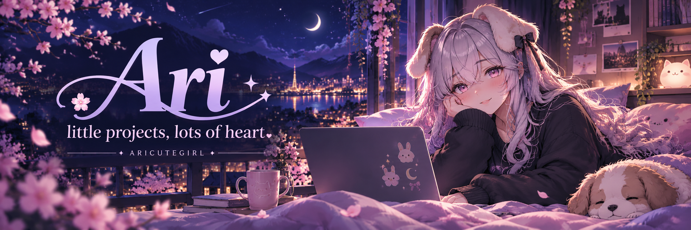
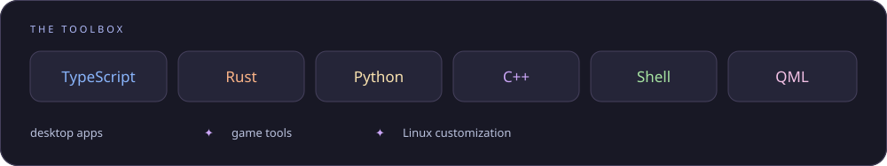

  

### hey, i'm Ari ♡

just a cutie patootie making things in her free time.

**cozy desktops · little tools · new life for old games**

[Explore my projects](https://github.com/AriCuteGirl?tab=repositories) · [What I've been building](https://github.com/AriCuteGirl?tab=overview) · [Stars & inspiration](https://github.com/AriCuteGirl?tab=stars)

 

## 🌸 a little about my corner of the internet

I make desktop apps, tinker with games, and give my Linux setup a little extra personality. Somewhere between useful and cute is where my projects tend to land.

- **On the desktop** — launchers, mail, and tools that make everyday things nicer.
- **In games** — server projects, save managers, and little experiments.
- **After hours** — Hyprland, Catppuccin colors, and cozy customization.

 

## ✨ things i've been making

<table>
<tr>
<td width="50%" valign="top">

### 🏰 [Dobyvatel Revival](https://github.com/AriCuteGirl/Dobyvatel-Revival)
Bringing the 2019 Android game back online with a Python server emulator and a custom-server Android client.

GAME REVIVAL · ANDROID · PYTHON

</td>
<td width="50%" valign="top">

### 🎢 [Theme Park EA Revival](https://github.com/AriCuteGirl/Theme-park-EA-Server)
Bringing EA's 2012 Theme Park back to life with a server emulator and a modern Android port.

GAME REVIVAL · ANDROID · SERVER EMULATOR

</td>
</tr>
<tr>
<td width="50%" valign="top">

### 🩺 [Surgeon Simulator 2 Private Server](https://github.com/AriCuteGirl/SurgeonSim2-Private-Server)
Restoring co-op play to Surgeon Simulator 2 with a community-made private server.

GAME REVIVAL · PC · CO-OP

</td>
<td width="50%" valign="top">

### 🖥️ [Server Manager GUI](https://github.com/AriCuteGirl/Server-Manager-GUI)
A cozy desktop app to set up, deploy, and manage private servers for revived games.

DESKTOP APP · WINDOWS + LINUX

</td>
</tr>
<tr>
<td width="50%" valign="top">

### 🐾 [PupBerg](https://github.com/AriCuteGirl/PupBerg)
A Goldberg Steam Emulator fork with a puppy-themed overlay, custom themes, and ZeroTier support.

GAME TOOLS · C++ · STEAM OVERLAY

</td>
<td width="50%" valign="top">

### 🌲 [Gravity Falls Umbriel Rice](https://github.com/AriCuteGirl/gravity-falls-umbriel-rice)
A portable Umbriel + Noctalia desktop with Catppuccin colors and a little Gravity Falls magic.

LINUX CUSTOMIZATION · SHELL

</td>
</tr>
</table>

  <a href="https://github.com/AriCuteGirl?tab=repositories"><b>the rest of the toy box →</b></a>

 

## 🧶 threads running through my projects

  

<b>🐾 a few more rabbit holes</b>

 

- [Theme Park server project](https://github.com/AriCuteGirl/Theme-park-EA-Server) — bringing an old park back to life.
- [Cirno Clicker](https://github.com/AriCuteGirl/Cirno-Clicker) — a little Cirno for Hyprland.
- [Surgeon Simulator 2 private server](https://github.com/AriCuteGirl/SurgeonSim2-Private-Server) — a co-op server project.

 

  

<!-- Original banner created with AI assistance. Profile artwork is stored in this repository; no tracking pixels or external stats services. -->
